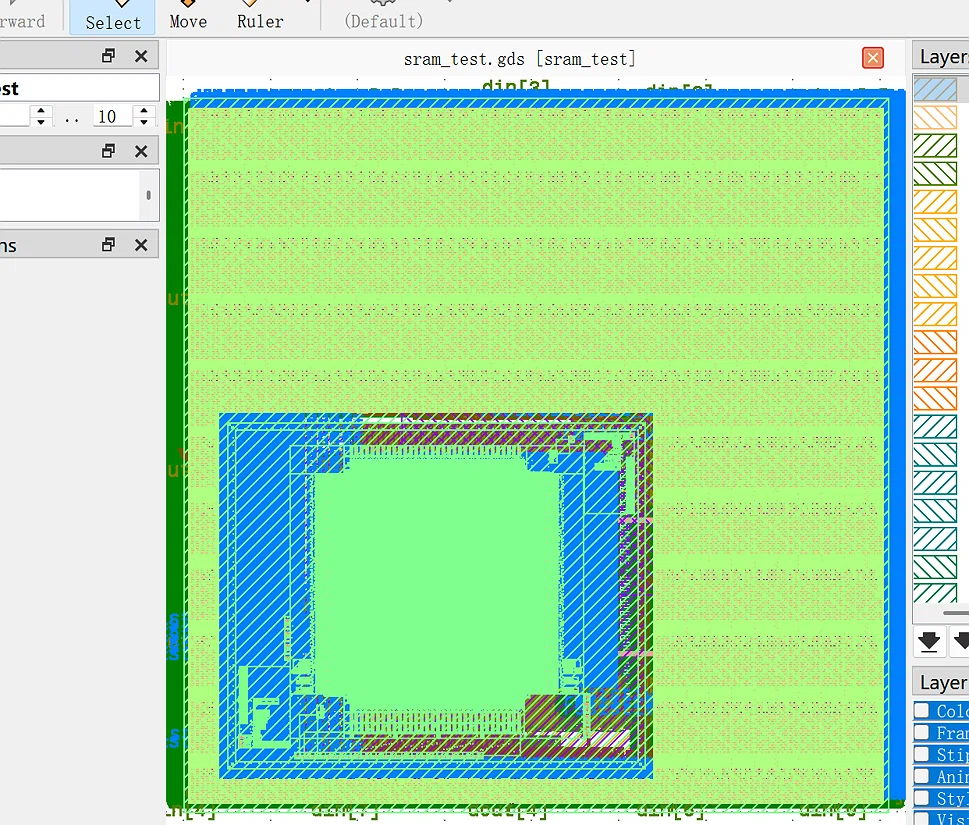

# digital-backend-learning

 数字后端学习与项目实战 (Digital Backend Portfolio)

**深圳大学微电子科学与工程（大三）** | **求职意向：数字后端 / DFT 实习生**

> 🚀 **实习时间**：寒假期间（1-2月）可全职实习；

---

## 🏆 核心项目：RISC-V 核物理实现与复杂宏单元集成 (SkyWater 130nm)

在开源流程下，独立完成 RISC-V CPU (PicoRV32) 从 RTL 到 GDSII 的全流程物理实现。

- **📊 最终 QoR 数据**：在 8ns (125MHz) 目标下，实现时序**完美收敛（WNS/TNS = 0.0）**，版图**零 DRC 违例**，总面积约 **0.248 mm²**。
- **🧱 SRAM 宏单元集成**：成功引入 1kbyte SRAM 宏单元，通过独立 Blackbox 模型解决综合报错，配置 PDN Power Ring 接入，并完成 Signoff 阶段的 LVS 物理验证分析。
- **⚡ 极限压榨探索**：主动挑战 6ns (166MHz) 极限频率，成功定位并解决严重布线拥塞 (`GRT-0119`)，深刻理解 CTS 阶段为平衡时钟偏斜（Skew）而做出的物理妥协。

*(附：KLayout 物理版图截图)*

---

## 🛠️ 技能栈

- **后端全流程**：熟悉 RTL-to-GDSII 全流程，深入理解 Floorplan、Placement、CTS、Routing 及 Signoff 的物理逻辑。
- **EDA 工具**：熟练使用 OpenLane / OpenROAD 开源工具链；了解 PrimeTime / Innovus 等商业工具。
- **脚本语言**：熟练编写 **Tcl** 脚本进行 EDA 工具控制与报告自动化解析；了解 Python。
- **理论基础**：扎实掌握 STA 时序分析（Setup/Hold、WNS/TNS、OCV 降额模型）、低功耗设计原理及 Linux 环境。

---

