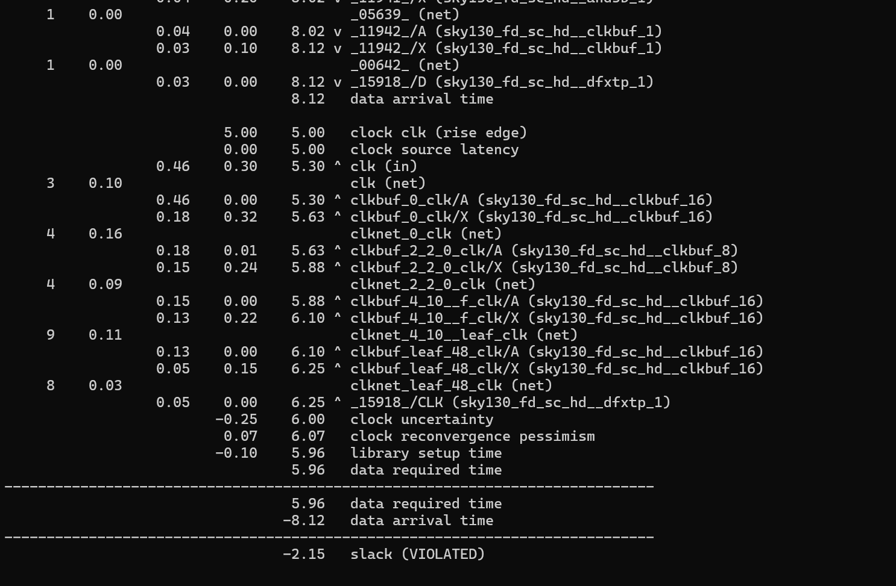
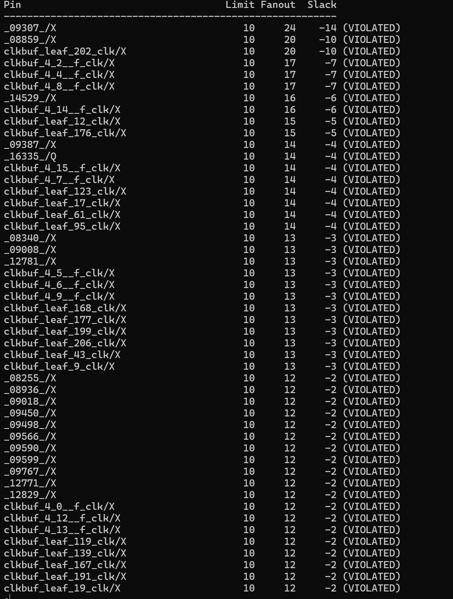
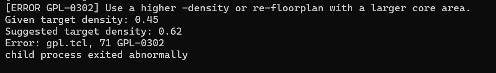
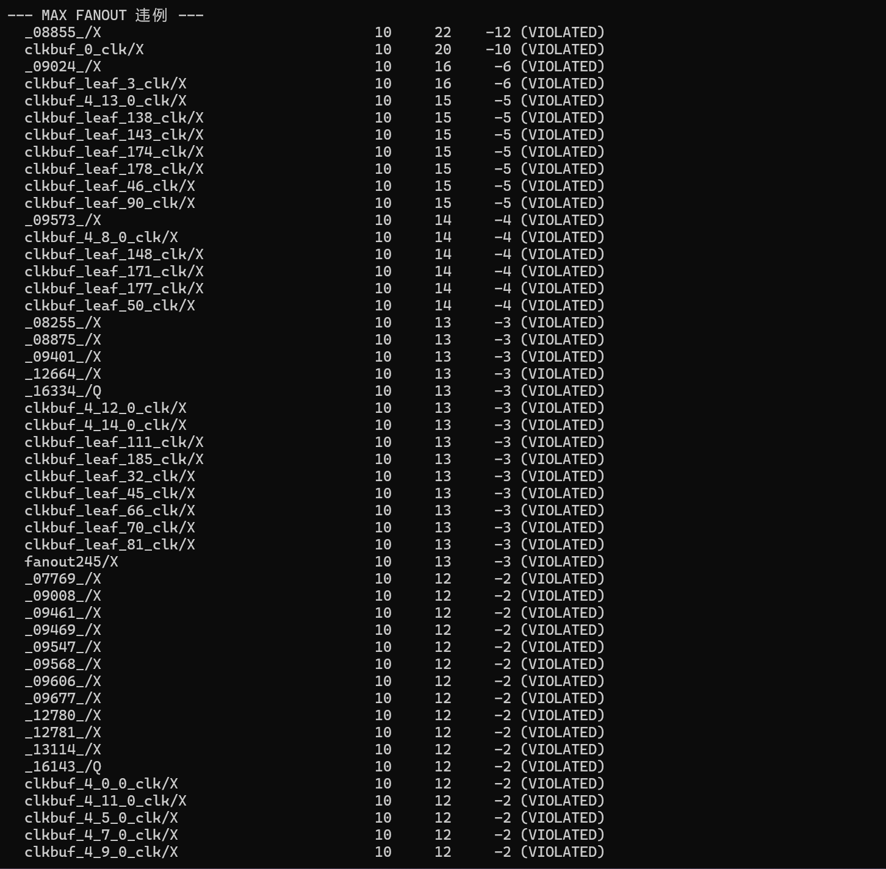
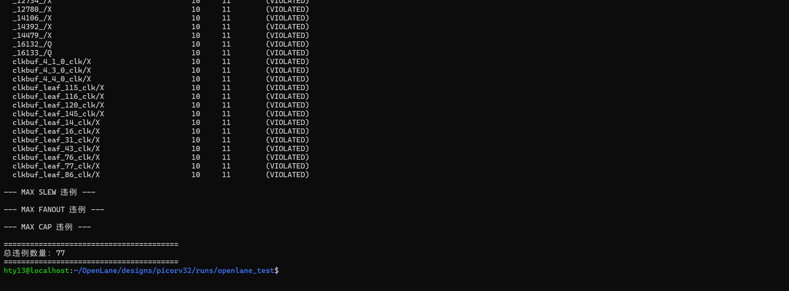

现象：将时钟周期从 15ns 提至 5ns 后，出现 Setup 违例（Slack = -2.15ns）。

分析：违例路径经过多级 and4/and3 组合逻辑，累计延迟高达 8.12ns，超过 5.96ns 的要求时间

全设计有上百个节点扇出超标。这就是 5ns（200MHz）跑不过的根本原因：一个逻辑门带了太多下级，电容负载极大，充放电极慢，导致信号跑得极慢（Slew 变差），最终引发 Setup 违例。
原因：
时序太紧：5ns 的周期下，工具无法通过普通的布局布线来满足时序。

综合优化不足：综合工具在映射逻辑时，可能没有对高扇出网络做足够的逻辑复制（Cloning）或缓冲器插入（Buffer Insertion）。

面积不够：之前设的 FP_CORE_UTIL 只有 40，面积太挤，工具没法插入多余的 Buffer，也没法放宽布局

## 踩坑记录：布局密度冲突报错
- **现象**：将 `FP_CORE_UTIL` 改为 60，`PL_TARGET_DENSITY` 改为 0.45 后，全局布局报错 `GPL-0302`。
- **原因**：核心利用率（60%）大于布局目标密度（45%），导致单元无法均匀塞入核心区域。目标密度必须大于全局利用率，工具才有操作空间。
- **解决**：将 `FP_CORE_UTIL` 调至 50，`PL_TARGET_DENSITY` 调至 0.55，重新跑 `make test` 成功。

原因：时钟树（CTS）存在严重的高扇出问题
解决方法：强制限制时钟树扇出（最关键）：
在 config.json 里添加（或找到并修改）这一行：
"MAX_FANOUT_CONSTRAINT": 8,
（这告诉工具：不管是数据路径还是时钟树，每个引脚最多驱动 8 个负载。之前默认是 10，而实际做到了 20，说明工具没严格执行，现在强制约束。）
给 CTS 留出物理空间：
把 "FP_CORE_UTIL" 改回 45（稍微扩大芯片面积）。
把 "PL_TARGET_DENSITY" 改成 0.50（降低布局密度，让工具在时钟树上有更多空间插 Buffer 来分摊扇出）。

结果：通过调整布局密度与面积约束，PicoRV32 的 Max Fanout 违例从 112 个降至 77 个，且时序（Setup/Hold）在 10ns 下完全收敛。剩余违例多为 CTS 叶节点轻微超标（Fanout 11/12，Limit 10），未影响时序，属于低风险警告