# PicoRV32 后端 Signoff 收敛与物理极限探索

## 📌 今日目标
将 PicoRV32 的时钟周期压榨至极限（6ns），测试工具的物理边界，并最终通过参数折中，完成最终版（8ns）的时序与物理双收敛签核。
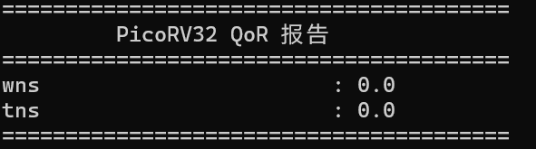
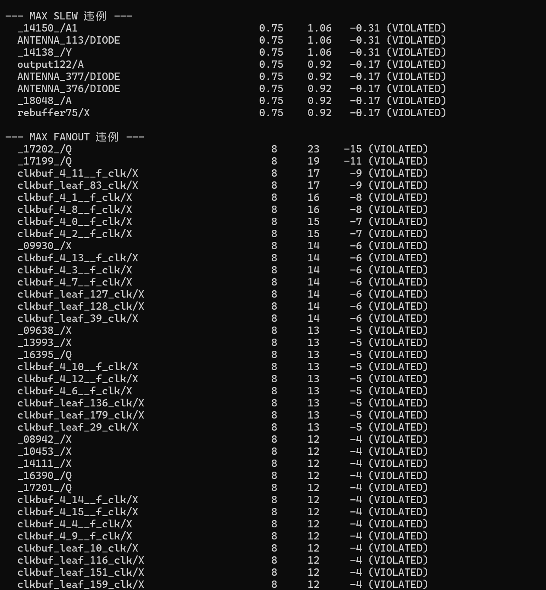
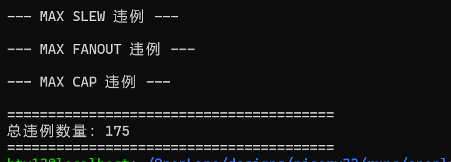
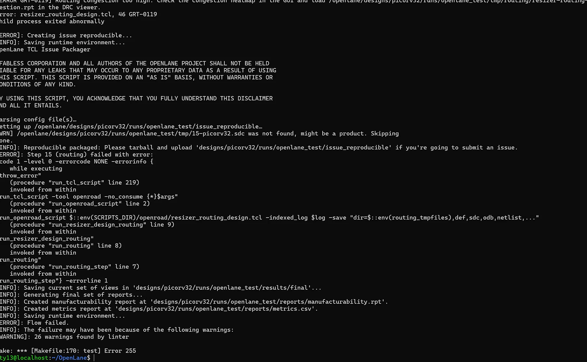
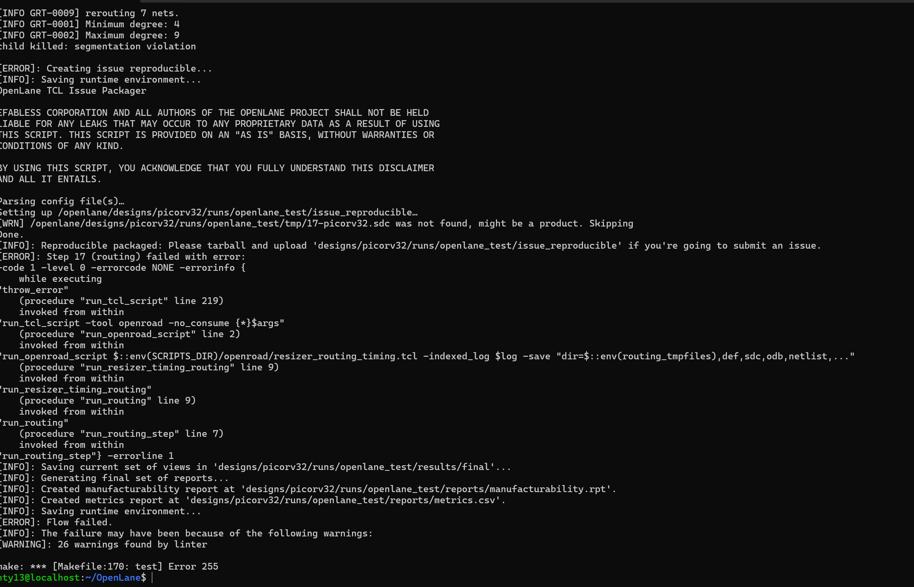
## 🚀 一、 极限频率探索 (6ns / 166MHz)
为了测试工艺极限，将 `CLOCK_PERIOD` 从 8ns 压缩至 6ns，并保留 `SYNTH_STRATEGY: "DELAY 0"` 综合策略。
- **遭遇灾难**：全局布线阶段报出 `GRT-0119`（严重布线拥塞），甚至导致 OpenROAD 工具发生 `Segmentation violation`（段错误崩溃）。
- **根因分析**：在 6ns 高压下，工具为了抢时序，疯狂插入大驱动单元和高扇出网络。同时由于 `FP_CORE_UTIL`（45%）留给布线的空间不足，导致局部布通性彻底崩溃。
- **参数折中验证**：将 `FP_CORE_UTIL` 调至 45%，`PL_TARGET_DENSITY` 调至 0.65（给布线留出呼吸空间）后，工具勉强跑通。但依然遗留了 194 个 Max Fanout 违例（时钟树为了保 Skew 拒绝拆分负载）。
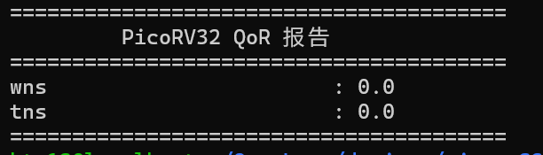
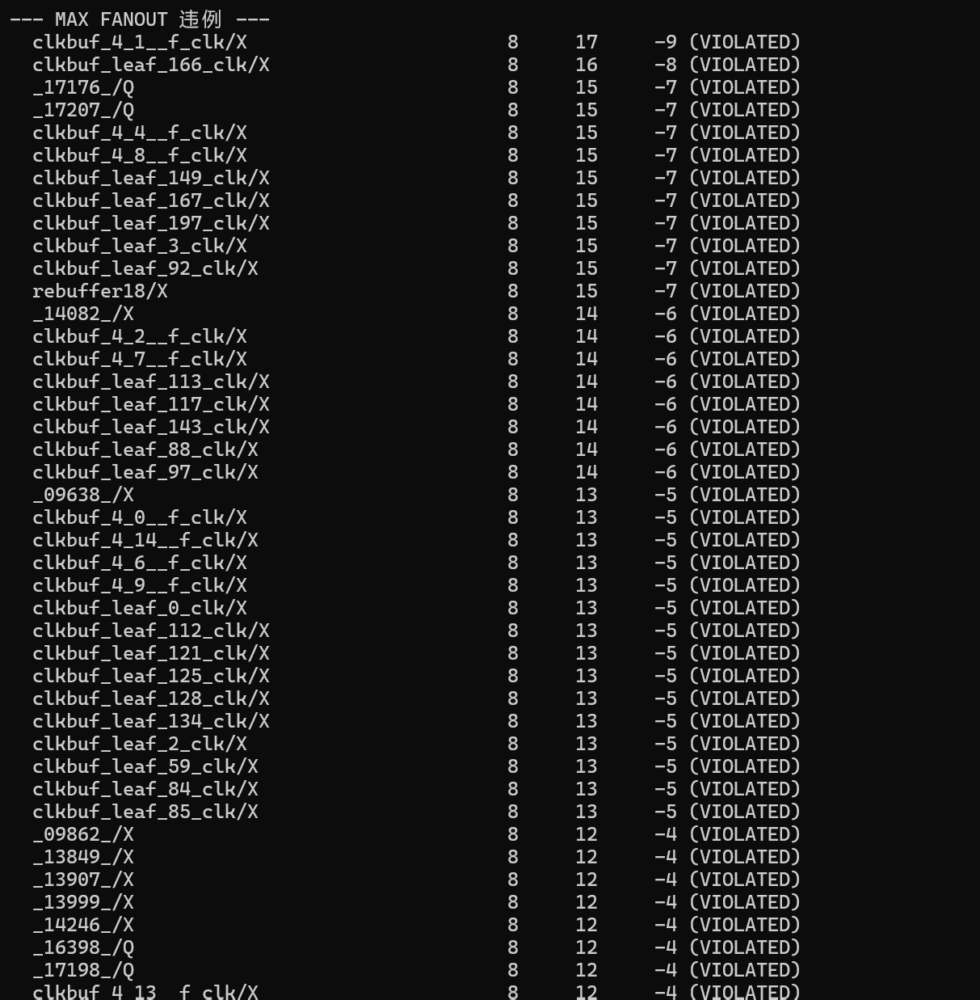
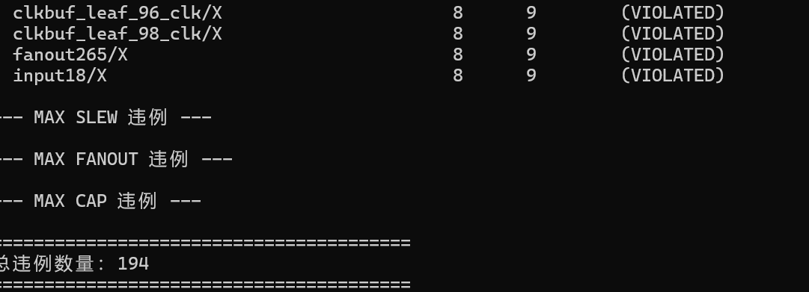
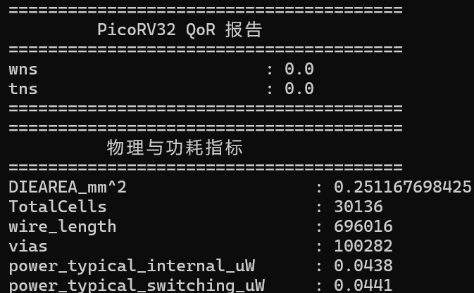

## 🎯 二、 回归 Signoff (8ns / 125MHz)
在探明物理极限后，为了保证设计的可制造性，将周期退回到工业界更合理的 8ns，并调整约束：
- `CLOCK_PERIOD`: 8
- `MAX_FANOUT_CONSTRAINT`: 10 （放宽原有限制，避免工具过度插 Buffer 导致时序崩溃）
- `FP_CORE_UTIL`: 45
- `PL_TARGET_DENSITY`: 0.60

## 📊 三、 最终 QoR 签核数据 (大满贯收敛)
通过修复 Tcl 脚本（分离 `metrics.csv` 与 `.rpt` 解析），提取出最终核心数据：
- **时序收敛**：WNS = 0.0 ns, TNS = 0.0 ns （无 Setup/Hold 违例）。
- **面积规模**：DIEAREA = 0.248 mm², 标准单元总数 = 29,662 个。
- **布线情况**：总线长 = 651,791 um，通孔数量 = 98,042，版图 **零 DRC 违例**。
- **功耗评估**：typical_internal = 0.0323 uW, typical_switching = 0.0311 uW。
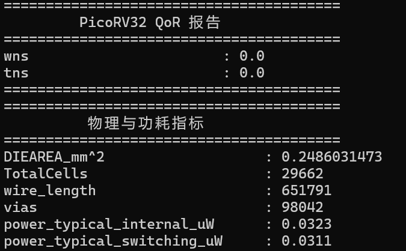
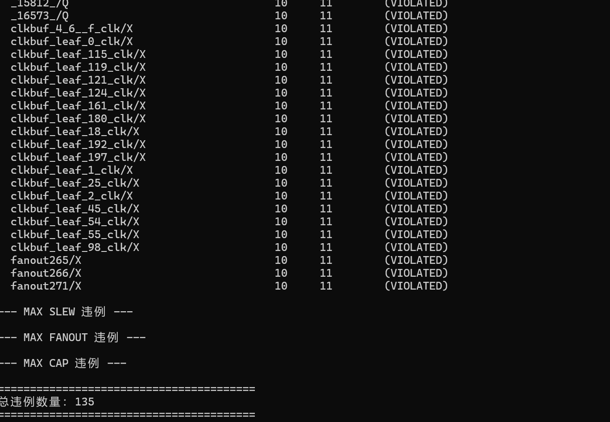

## 🔍 四、 遗留违例分析 (Why Waive?)
最终报告仍显示 135 个 Max Fanout 违例及极少数 Slew 违例：
- **Fanout 违例**：集中在时钟树叶节点（`clkbuf_leaf_...`），Limit 10，实际 11~13。
- **Slew 违例**：仅有几个输出端口和天线二极管，超标值在 -0.06ns 左右。
- **工程结论**：在 CTS 阶段，工具为了优先保证时钟偏斜（Skew），拒绝强行插入 Buffer 拆分扇出。这种程度的轻微超标未引发任何真实时序（Setup/Hold）违例。在真实流片的 Signoff 阶段，此类未影响时序的物理违例通常被 **Waive（豁免）**。

## 🛠️ 五、 工程自动化沉淀
- 完善了 `qor_summary.tcl` 和 `parse_all_violations.tcl`，实现了从动辄几十万行的 CSV 和 RPT 文件中，一键提取核心指标（WNS/TNS、面积、功耗）与违例引脚。
- 建立了 `notes/`、`images/`、`scripts/` 标准 Git 仓库结构，实现了工程数据的版本控制与知识沉淀。