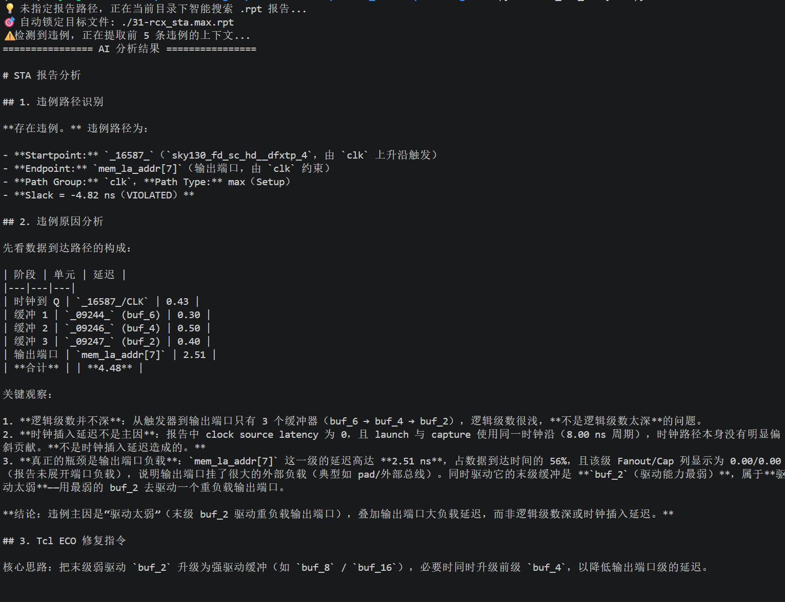

# AI+EDA Pipeline 实战：从 LLM 诊断到 ECO 修复指令生成

## 📌 背景
在之前的开发中，我构建了 `ai_sta_analyzer.py`，用于调用大模型 API 分析 OpenROAD 的 STA 报告。为了验证其能力，我模拟了一条严重的 Setup 违例（Slack = -4.82ns），测试 AI 的诊断能力。

## 📊 AI 诊断结果（令人惊艳）
大模型不仅精准定位了路径，还自动将延迟数据制表拆解，并排除了常见的逻辑级数深、时钟延迟等误判，给出了极其专业的结论：

> **违例主因是“驱动太弱”**：输出端口负载高达 2.51ns（占总延迟 56%），而末级缓冲器仅使用了最弱的 `buf_2`，属于典型的“小马拉大车”。



## 🛠️ AI 给出的 ECO 修复方案
AI 自动生成了 Tcl 修复指令，建议将末级及前级 Buffer 尺寸升级：

```tcl
# 初步修复
size_cell _09247_ sky130_fd_sc_hd__buf_8
size_cell _09246_ sky130_fd_sc_hd__buf_8