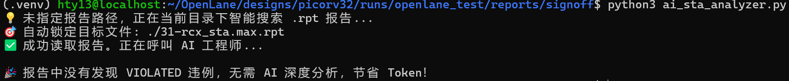

# 2026-11-05 学习日志：AI 赋能数字后端 —— 自动化时序分析 Pipeline 开发

## 📌 今日目标
打破传统手动分析 STA 报告的繁琐流程。利用 Python 结合大语言模型（LLM）API，构建一个具备“智能搜索”与“防呆机制”的自动化时序诊断工具。

## 🚀 一、 核心突破：Python 驱动的大模型自动化分析

今天成功跑通了 `ai_sta_analyzer.py` 脚本，实现了一个高鲁棒性的数据处理闭环：

1. **环境搭建与隔离**：在 Ubuntu 下使用 `venv` 创建独立 Python 环境，成功安装 `openai` SDK，并通过系统环境变量 (`export DEEPSEEK_API_KEY`) 安全管理 API 密钥，杜绝敏感信息泄露。
2. **智能化命令行接口 (CLI)**：引入 `argparse` 与 `glob` 模块。脚本支持两种运行模式：
   - **智能搜索**：直接运行脚本，它会自动扫描当前目录下的 `.rpt` 报告文件。
   - **精准指定**：通过 `python3 ai_sta_analyzer.py <path>` 分析指定路径的报告。
3. **工程防呆机制 (Gatekeeper)**：在调用 API 之前，脚本会先用 Python 正则扫描文本。**如果报告中没有 `VIOLATED` 关键字，脚本直接退出并打印“节省 Token”提示**；只有检测到真实违例，才会唤醒 AI 进入诊断模式。
4. **Prompt 工程与结果落盘**：设定“资深后端工程师”人设，要求大模型精准拆解延迟构成并生成 Tcl `size_cell` 修复指令。最终分析结果自动保存为 `ai_analysis_result.md`。

## 🔍 二、 实战复盘与反思
- **测试结果**：在当前 8ns PicoRV32 设计下，由于时序过于完美，脚本成功触发了防呆机制，控制台输出“未发现违例，节省 Token”。
- **工程价值**：这证明了自动化工具必须结合工程实际。AI 固然强大，但无脑调用只会浪费资源。利用确定性的物理规则（如正则匹配）做前置校验，让 AI 在真正需要“救火”的时候才介入，这才是合格的 AI+EDA 开发者思维。

## 💡 学习心得
**AI 是加速器，但物理逻辑是刹车片。** 在没有 AI 的时候，我们需手动翻看几十万行报告；有了 AI，一键即可生成诊断建议。但大模型不懂物理约束，脚本中的“防呆机制”和人工复核依然不可替代。这正是数字后端工程师的护城河

