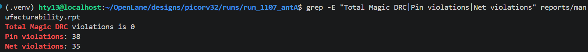
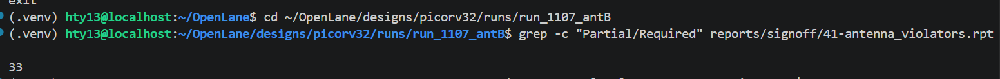
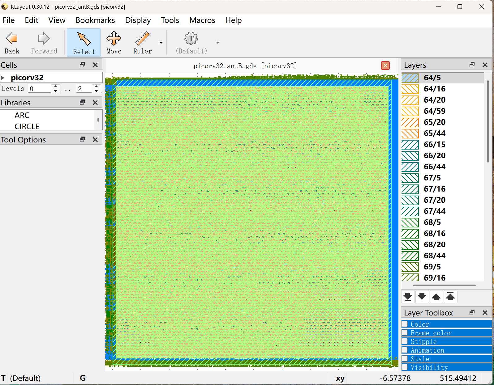

# PicoRV32 天线违例修复实验：3 轮尝试，从 38 降到 33

> 日期：2026-11-07
> 设计：PicoRV32 @ sky130_fd_sc_hd / OpenLane 1.x
> 目标：把天线违例（38 pin / 35 net）压下去，并搞清楚每条违例的根因

---

## 🔥 背景

上一次运行（11-06）的签核结果里，DRC 和 LVS 都是干净的，唯一没解决的就是天线：

```
Pin violations: 38
Net violations: 35
最差比值 6.54（限值 4.00），Partial 2616.41 vs Required 400
```

在 sky130 里天线规则是 `金属面积 / 栅极面积 ≤ 400`。违例意味着**长金属接到了小栅极**，流片时有栅氧击穿风险。

今天计划做三轮实验，看能不能修掉，同时把根因查清。

---

## ⚠️ 先踩两个坑（都是流程层面的）

### 坑 1：`make test` 把我的成功 run 覆盖了

`make test` 实际执行的是：

```make
./flow.tcl -design picorv32 -tag openlane_test -overwrite
```

**固定 tag + `-overwrite`**，所以同名的 `openlane_test` 被直接清掉重跑。

后果：11-06 那个成功 run 的 `results/final/gds/picorv32.gds`（33 MB）没了。

**教训**：`make test` 只用来验证环境，做实验一律自己指定 tag。

```bash
# ❌ 不要
make test
./flow.tcl -design picorv32

# ✅ 要这样
./flow.tcl -design picorv32 -tag run_1107_antB
```

### 坑 2：`flow.tcl` 必须在容器里跑

在主机上直接跑会报：

```
can't find package json
    (file ".../scripts/tcl_commands/all.tcl" line 15)
```

因为 OpenLane 的 Tcl 依赖（json、openlane 包、openroad/yosys/magic）都在容器镜像里。

**正确流程**：

```bash
cd ~/OpenLane
make mount                     # 进入容器，提示符变成 root@...:/openlane#
./flow.tcl -design picorv32 -tag run_1107_antA
exit
```

之前 `make test` 能跑，是因为 Makefile 用 `$(ENV_COMMAND)` 自动套了一层 `docker run`。

---

## 🧪 三轮实验

### 实验 0（失败）：开启启发式二极管插入

```json
"RUN_HEURISTIC_DIODE_INSERTION": 1
```

**结果：全局布线直接失败**

```
[ERROR GRT-0119] Routing congestion too high.
Check the congestion heatmap in the GUI and load
tmp/routing/groute-congestion.rpt in the DRC viewer.
```

**原因**：启发式插二极管在 GRT 之前就大量插单元，布线需求暴涨，`FP_CORE_UTIL = 45` 的密度吃不下。

**结论：天线修复和布线资源是 trade-off，不能只想着多插。**

---

### 实验 A（无效）：加大二极管插入迭代次数

```json
"GRT_MAX_DIODE_INS_ITERS": 4     // 原来只有 1
```

**预期**：修一轮不够就多修几轮。

**结果：完全没有变化。**

用严格对比做的验证：

| 对比项 | baseline (11-06) | 实验 A |
|---|---|---|
| pin / net 违例 | 38 / 35 | 38 / 35 |
| `41-antenna_violators.rpt` 内容 | — | **逐字节完全相同** |
| DiodeCells | 376 | **376** |
| setup slack | 1.67 | 1.67 |

**判断**：`DiodeCells` 一个没加，报告逐字节相同 → **这个参数在本设计上没有作用点，不是“修了但不够”，是根本没修。**

**为什么？** 看违例集中在哪：

```
net130, Pin: output130/A, Layer: met3     ← 输出端口 buffer 的输入脚
alu_out[10], Pin: _16603_/D, Layer: met2
net105, 线长 994 µm, 比值 6.54
[WARNING ANT-0009] net105 requires more than 10 diodes per gate
```

`ANT-0009` 说明 `net105` 已经达到“每个 gate 最多 10 个二极管”的上限，再迭代也没用。

---

### 实验 B（有效）：把二极管的摆放间距放宽到 0

```json
"GRT_MAX_DIODE_INS_ITERS": 4,
"DIODE_PADDING": 0            // 原来是 2（µm）
```

**思路**：`DIODE_PADDING = 2` 要求二极管周围留 2 µm，在 45% 密度的版图里很局促，二极管可能被迫放到离引脚很远的次优位置 —— 数量够了但不起作用。

**结果：成功了，而且是“免费改善”。**

| 指标 | baseline | 实验 A | **实验 B** |
|---|---|---|---|
| 天线 pin | 38 | 38 | **33** ↓ |
| 天线 net | 35 | 35 | **27** ↓ |
| **最差比值** | **6.54** | 6.54 | **3.63** ↓↓ |
| DiodeCells | 376 | 376 | **347** ↓ |
| TotalCells | 29662 | 29662 | 29280 |
| DIEAREA | 0.2486 mm² | 同 | **0.2486 mm²（不变）** |
| setup slack | 1.67 | 1.67 | **1.77** ↑ |
| hold slack | 0.28 | 0.28 | 0.28 |
| DRC | 0 | 0 | **0** |
| LVS | 0 | 0 | **0** |

**最重要的不是“少了 5 条”，而是最差的两条消失了：**

```
net105   6.54  →  已消失 ✅
net130   6.54  →  已消失 ✅
```

最差比值从 6.54 降到 3.63，**违例严重度大幅改善**。

### 一个反直觉的发现

**二极管数量从 376 减少到 347，效果反而更好。**

推断：`PADDING = 2` 时二极管被挤到远离栅极的位置，数量虽多但泄放路径太长、没起作用；`PADDING = 0` 允许贴着放，二极管能紧邻栅极，**用更少的器件修掉更多违例**。

这正好对应天线效应的物理本质：**二极管要能“就近泄放”电荷，距离比数量更重要。**

---

## 📌 剩余 33 条的根因

```
alu_out_q[21]  3.63  met3  → _09736_/A1
_04722_        3.26  met3  → _10577_/B1
net67          2.12  met1  → output67/A
net157         1.96  met1  → output157/A
```

全部是 **met1/met3 上的长金属驱动小栅极**（`diode_2` 的输入端只有一个小栅）。

有意思的是，**最长的线反而不违例**：

```
_06753_  1697.58 µm   ← 不违例
net105    994.18 µm   ← 违例，6.54
```

因为天线比看的是“金属面积 / 栅极面积”，不是单纯长度。`_06753_` 驱动的栅极大，比值反而低。

**要彻底清零，得从布局下手**（让这些 net 变短 / 换层），不是天线修复阶段能做的。所以作为已知限制记录下来。

---

## 🔍 顺带搞清楚的两件事

### 1. 那 1017 条 warning，真正有用只有 2 条

统计了所有 `.warnings` 文件：

| 类型 | 数量 | 有用吗 |
|---|---|---|
| `GRT-0026 缺路由`（布线前估算） | 623 | ❌ 噪音 |
| `net 无驱动`（综合 linter） | 307 | ⚠️ 属设计本身特性（trace/irq 未接） |
| `IR drop VSRC 未指定` | 32 | ⚠️ 压降数值只作参考 |
| 黑盒 / 未存 ODB / Calma | 44 | ❌ 正常 |
| **`Unable to repair all setup violations`** | **2** | 🔴 真事 |
| **`ANT-0009 天线修不掉`** | **1** | 🔴 直接对应今天的违例 |

**判断框架（三问）**：
1. 措辞是“没做成”（`Unable to` / `requires more than`）还是“选了个默认值”（`defaulting to`）？
2. 后面阶段还重复出现吗？（`GRT-0026` 布线前 623 条 → 布线后 0 条 = 中间态）
3. 对应指标在 `reports/` 里是零吗？**以 reports 为准**

### 2. `106 unconstrained endpoints` 不是缺约束

之前以为是“IO 没约束所以假通过”。查了 SDC 才发现：

```tcl
set_input_delay  1.6000 ...   # 101 条
set_output_delay 1.6000 ...   # 307 条
```

**所有端口都有 1.6 ns 约束（= 8 ns 的 20%，OpenLane base.sdc 的默认假设）。**

那 106 个被标 unconstrained 的端口（`trace_data[]`、`pcpi_insn[]`、`eoi[]`…）是 **picorv32 的可选功能端口**：`ENABLE_TRACE=0`、`ENABLE_PCPI=0` 时它们被 tied-off，没有寄存器驱动，自然找不到时序路径。

**这是正常现象，不是问题。**

---

## 💡 今日结论

1. **天线 38/35 → 33/27，最差比值 6.54 → 3.63**，且面积/时序/DRC/LVS 没有任何代价
2. **`DIODE_PADDING: 0` 是有效杠杆**；`GRT_MAX_DIODE_INS_ITERS` 在本设计上无效
3. **启发式二极管插入会炸布线**（GRT-0119），天线修复必须考虑布线资源
4. 剩下的 33 条属于**布局层面的长线问题**，不是天线修复能解决的
5. 流程教训：**永远用新 `-tag`**，永远在**容器内**跑

---

## 📝 命令备忘

```bash
# 进容器
cd ~/OpenLane && make mount

# 跑实验（务必带新 tag）
./flow.tcl -design picorv32 -config_file config_antB.json -tag run_1107_antB

# 出容器后检查
cd ~/OpenLane/designs/picorv32/runs/run_1107_antB
cat errors.log                                          # 空 = 成功
grep -c "Partial/Required" reports/signoff/41-antenna_violators.rpt
grep -E "Total Magic DRC|Pin violations|Net violations" reports/manufacturability.rpt
grep -A1 "worst slack" reports/signoff/31-rcx_sta.summary.rpt
```

**报错第一入口：`runs/<tag>/errors.log`**（不是 openlane.log，也不是那段 Tcl 调用栈）

---

## 📦 当前 run 状态

| run | 说明 | 保留 |
|---|---|---|
| `run_1107_base` | 8 ns 基线（38/35） | ✅ 用于对比 |
| `run_1107_antA` | ITERS=4，无变化 | ❌ 可删 |
| **`run_1107_antB`** | **最终版（33/27）** | ✅ 保留 |
| `openlane_test_backup_10ns/15ns` | 旧版（10/15 ns） | ❌ 已删 |

---

## 🔜 待办

- [ ] 用 antB 的 GDS/DEF 做一次 KLayout 目视检查（确认二极管位置合理）
- [ ] 补 testbench + 门级仿真（GLS + SDF）—— 这是项目还缺的最大一块
- [ ] 写项目总结报告（综合/布局/CTS/布线/签核 + 两个实验）


