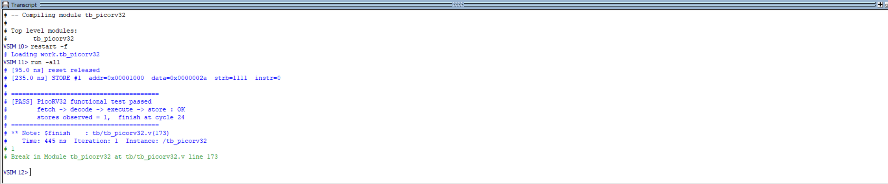
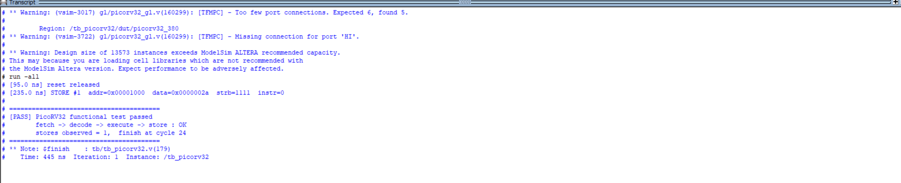

PicoRV32 功能验证：从写 TB 到零延时 GLS 跑通
日期：2026-11-08 项目：PicoRV32 @ sky130（物理实现已完成，DRC/LVS/STA 全过） 目标：补上"功能验证"这块空白，让项目形成完整闭环

🔥 背景
物理实现已经做完：GDS 33 MB、DRC 0、LVS 0、setup +1.77 ns、hold +0.28 ns。

但从来没跑过一次仿真——这是项目最大的结构性缺口：只有"物理上做出来了"，没有"功能上是对的"。

今天补这一块。

🧪 一、testbench 设计
设计原则：自检查（不需要人看波形就能判 PASS/FAIL）。

部件	实现
存储器模型	64 KB，零等待（assign mem_ready = mem_valid），支持 byte write strobe
激励	8 条 RV32I 指令
检查器	在存储接口抓 mem_addr == 0x1000 && mem_wdata == 42 的写
判分	命中 → [PASS] 并 $finish；5000 周期未命中 → [FAIL] TIMEOUT
测试程序（手算的 RV32I 机器码）
地址	指令	编码	作用
0x00	lui x1, 0x1	0x000010B7	x1 = 0x1000
0x04	addi x2, x0, 42	0x02A00113	x2 = 42
0x08	sw x2, 0(x1)	0x0020A023	mem[0x1000] = 42（判据）
0x0c	lw x3, 0(x1)	0x0000A183	读回
0x10	beq x2, x3, +8	0x00310463	相等则跳过失败路径
0x14	addi x4, x0, 1	0x00100213	失败路径
0x18	addi x4, x0, 2	0x00200213	成功路径
0x1c	jal x0, 0	0x0000006F	死循环
为什么只抓一笔 store 就够：这一笔写成立，说明"取指 → 译码 → 执行（lui/addi）→ 访存"整条链路都通了。如果取指错了，地址不会是 0x1000；如果 ALU 错了，数据不会是 42；如果分支错了，会多出第二次写。

✅ 二、RTL 仿真通过
代码块

[95.0 ns] reset released
[235.0 ns] STORE #1  addr=0x00001000  data=0x0000002a  strb=1111  instr=0

========================================
[PASS] PicoRV32 functional test passed
       fetch -> decode -> execute -> store : OK
       stores observed = 1, finish at cycle 24
========================================
逐项核对：

字段	值	含义
addr	0x00001000	正是 sw 的目标地址
data	0x0000002a	= 42，正是 addi x2, x0, 42
strb	1111	4 字节全写，sw 正确
instr	0	数据访问，不是取指
stores	1	beq 正确跳过了失败路径
🧱 三、GLS 三个坑（都踩了）
坑 1：-sdf max 写法错误
代码块

Error: (vish-3296) Unknown option '-sdf'.
ModelSim 的写法是 -sdfmax（一个词，无空格），不是 -sdf max。

坑 2：PDK 模型里的 default_nettype none
代码块

Error: lib/sky130_fd_sc_hd.v(150394): (vlog-2892)
       Net type of 'C' must be explicitly declared.
PDK 单元模型开头有：

verilog

`timescale 1ns / 1ps
`default_nettype none      ← 这里
在 none 模式下，input C; 这种隐式网络声明被 ModelSim 10.1d 判为非法（新版本能容忍）。

解决：预处理掉这一行

bash

grep -v 'default_nettype' lib/sky130_fd_sc_hd.v > lib/sky130_fd_sc_hd_sim.v
坑 3：USE_POWER_PINS 不匹配（最隐蔽）
代码块

Error: (vsim-3389) Port 'VGND' not found in the connected module
Region: /tb_picorv32/dut/ANTENNA_1
Fatal: Too many port connections. Expected 1, found 5.
根因：OpenLane 生成的 GLS 网表带电源引脚——每个单元实例都接 VPWR / VGND / VPB / VNB。

而 PDK 模型里每个单元有 4 个条件编译版本：

分支	端口数	有 specify
USE_POWER_PINS + 功能	功能脚 + 4 电源脚	无
USE_POWER_PINS + 时序	功能脚 + 4 电源脚	有
无 define + 功能	只有功能脚	无
无 define + 时序	只有功能脚	有 ← 默认
默认编译得到的是 1 个端口，网表却连 5 个 → 端口数不匹配。

解决两步：

代码块

# 1) 编译库时开宏
vlog -work work_gls +define+USE_POWER_PINS lib/sky130_fd_sc_hd_sim.v
vlog -work work_gls +define+USE_POWER_PINS gl/picorv32_gl.v
verilog

// 2) TB 里给 DUT 补上电源端口
wire vpwr = 1'b1;
wire vgnd = 1'b0;
picorv32 dut ( ... , .VPWR(vpwr), .VGND(vgnd) );
⚠️ 这个宏只管"端口声明"，不影响功能；默认走时序分支，正好是 GLS 需要的。

❌ 四、走不通的一条路：SDF 反标
接上电源引脚后，-sdfmax 抛出：

代码块

** Fatal: SDF files require Altera primitive library
ModelSim Altera Starter Edition 限制：SDF 反标只允许用于 Altera 原语库，第三方库（sky130）直接被拒。

这是工具授权限制，不是设计问题。

应对：先做零延时 GLS（验证网表功能），时序交给 STA。

✅ 五、零延时 GLS 通过
代码块

vsim work_gls.tb_picorv32 -do "run -all"
代码块

[95.0 ns] reset released
[235.0 ns] STORE #1  addr=0x00001000  data=0x0000002a  strb=1111  instr=0
[PASS] PicoRV32 functional test passed
       stores observed = 1, finish at cycle 24
Time: 445 ns
网表规模：13,573 个实例。结果与 RTL 完全一致（时间、周期、数据全同）。

（顺带一条 warning：Design size of 13573 instances exceeds ModelSim ALTERA recommended capacity —— 只是性能提示，不是错误。）

📊 六、现在项目的证据链
验证层	手段	结果	是谁证明的
功能正确（RTL）	RTL 仿真	✅ PASS	testbench
功能正确（网表）	零延时 GLS	✅ PASS	testbench
时序正确	OpenSTA 签核（rcx max/min）	✅ +1.77 / +0.28	STA
物理正确	DRC / LVS / XOR	✅ 0 / 0 / 一致	Magic + KLayout
关键认识：零延时 GLS 证明的是"网表功能等价"，不是"时序没问题"。时序由 STA 独立证明——而且 STA 比 GLS 更严格，因为它检查所有路径，GLS 只检查激励覆盖到的路径。

💡 七、今天学到的东西
TB 的核心不是"喂激励"，是"自动判分" —— 人看波形不可扩展
PASS 判据要选"一个点覆盖多条链路" —— 一笔 store 同时验证取指、译码、ALU、访存、分支
GLS 的坑 80% 来自"网表和库的编译选项不一致"，不是设计问题
工具限制要学会识别：SDF files require Altera primitive library 明显是 license/版本限制，不要往设计上找原因
判据不能依赖时序巧合 —— 初版靠 mem_addr 在下一拍仍保持原值才触发 PASS，虽然能跑通，但换时序就可能失效，后来改成 if (pass_seen) 直接触发
📝 八、命令备忘
代码块

# 每次启动 ModelSim 第一件事：切到项目目录
cd D:/IC_project/picorv32/sim

# ---- RTL 仿真 ----
vlib work
vlog rtl/picorv32.v
vlog tb/tb_picorv32.v
vsim -c work.tb_picorv32 -do "run -all"        # 不要加 quit -f！

# ---- 零延时 GLS ----
vlib work_gls
vlog -work work_gls lib/primitives.v
vlog -work work_gls +define+USE_POWER_PINS lib/sky130_fd_sc_hd_sim.v
vlog -work work_gls +define+USE_POWER_PINS gl/picorv32_gl.v
vlog -work work_gls +define+GLS tb/tb_picorv32.v
vsim work_gls.tb_picorv32 -do "run -all"
quit -f 会关掉整个 ModelSim；只想卸载设计用 quit -sim；重置时间用 restart -f。

🔜 九、待办
 用 Icarus Verilog 补做带 SDF 的时序 GLS（免费，支持 $sdf_annotate）
 给 TB 加覆盖率统计（至少统计执行过的指令类型）
 寒假：把 TB 改写成 UVM 风格
 报告里补上 GLS 截图

