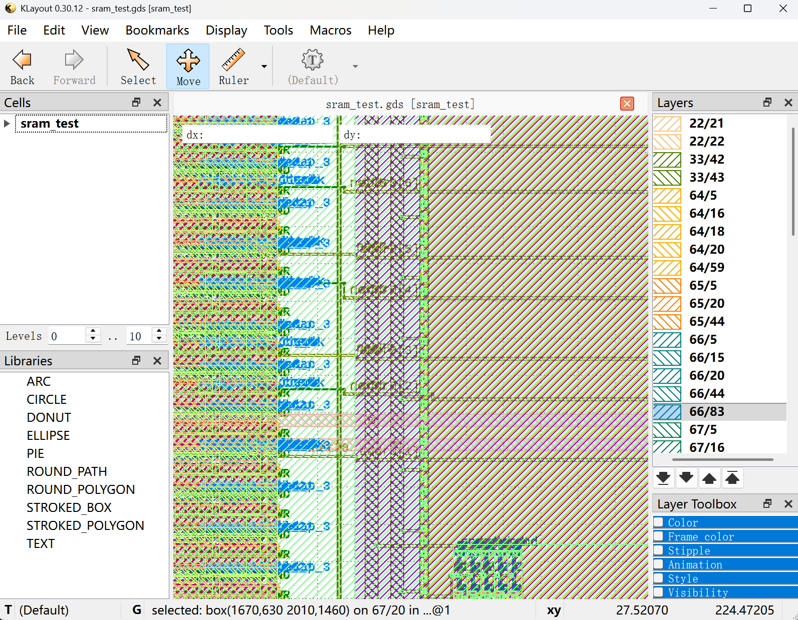

# SRAM 集成：37 个 LVS 错误 → 0，283 万 DRC 违例 → 3

> 2026-11-14 · OpenLane 1.x / sky130A / WSL Ubuntu
> 设计：`designs/sram_test`（SRAM 集成的最小验证载体：1 个宏 + 49 个标准单元）
> 宏：`sky130_sram_1kbyte_1rw1r_32x256_8`（1 KB，单写单读，32 位）

## TL;DR

| 阶段 | LVS | Magic DRC | 流程 |
|---|---|---|---|
| 初始 | 37 errors / 13 unmatched pins | 未执行（LVS 先中断） | `[ERROR]: Flow failed.` |
| 修 hook 顺序 | **0** | 2,831,854 → 改为读 DEF | 卡在 rosetta，8 GB 内存耗尽 |
| 收窄 DRC 口径 | **0** | **3**（全在宏左边界） | **`[SUCCESS]: Flow complete.`** |

三个错误**都没有报错**：一个伪装成"LVS 报 37 个看不懂的错"，一个伪装成"DRC 报 283 万违例"，一个伪装成"我明明关了它为什么还停"。

---

## 1. 为什么单独造一个 sram_test

直接在 PicoRV32 上挂 SRAM，会把"宏集成"和"CPU 逻辑"两类问题搅在一起。先用 1 个宏 + 几十个单元把这条链路跑通，再回大设计：

```
RTL 黑盒声明 → 综合读 .lib → 布局固定宏 → PDN 连宏电源 → 布线 → GDS → LVS 比对 → DRC
```

`sram_test` 只有 8 位数据通路，其余引脚常量绑定（`csb0=0`、`web0=1`、`wmask0=4'b1111`），综合后 49 个单元——**任何错误都只可能来自宏集成本身。**

---

## 2. 错误一：`FP_PDN_MACRO_HOOKS` 参数顺序

```diff
- "FP_PDN_MACRO_HOOKS": "u_sram VPWR VGND VPWR VGND"
+ "FP_PDN_MACRO_HOOKS": "u_sram VPWR VGND vccd1 vssd1"
```

参数顺序是 **`<实例名> <电源网名> <地网名> <电源引脚名> <地引脚名>`**，不是 `<实例> <电源引脚> <地引脚> <电源网> <地网>`。

**源码取证**

- `~/OpenLane/scripts/openroad/common/set_global_connections.tcl:40-44` — 按此顺序取参，生成 `add_global_connection -net <网> -inst_pattern <实例> -pin_pattern <引脚>`
- `~/OpenLane/scripts/tcl_commands/floorplan.tcl:360-378` — 同样顺序解析，且第 2/3 参数必须在 `VDD_NETS`/`GND_NETS` 里
- `~/OpenLane/scripts/openroad/common/set_global_connections.tcl:19-34` — 流程只对 `STD_CELL_POWER_PINS`（VPWR/VGND）做 `.*` 全局连接，**宏电源脚不显式 hook 就没人连**

**为什么这个错难找**：写错后 `add_global_connection -pin_pattern VPWR -inst_pattern u_sram` 在 `u_sram` 上匹配到 **0 个 iterm**，OpenROAD **不报错、不警告**，直接跳过。流程一路跑到 signoff 才在 LVS 炸掉。

这个 SRAM 的真实电源引脚名是 `vccd1` / `vssd1`：

```bash
grep -n -A2 '^PIN vccd1' \
  ~/.ciel/sky130A/libs.ref/sky130_sram_macros/lef/sky130_sram_1kbyte_1rw1r_32x256_8.lef
```

### LVS 侧的症状链

```
[623] Number of nets: 204 Mismatch | Number of nets: 202 Mismatch
[833] Net: u_sram/vccd1 | Net: _NC30
[836] Net: u_sram/vssd1 | Net: _NC31
```

版图抽取的 SPICE（`results/signoff/sram_test.spice`）里 `u_sram/vccd1`、`u_sram/vssd1` 是**浮空网**；网表侧（`tmp/signoff/37-sram_test.pnl.v`）却写着 `.vccd1(VPWR) .vssd1(VGND)`——因为 `write_powered_verilog` 会按 LEF 的 `USE POWER/GROUND` **自动补**电源连接，跟 RTL 写没写无关。

于是两侧各多出一个不存在的网（`_NC30`/`_NC31`）→ net count 差 2 → 连带 fill/decap 的电源网编号错位（`VPWR = 173|174`）→ 最终 37 errors / 13 unmatched pins。

> **反直觉点**：网表侧看起来"连对了"，是工具按 LEF 自动补的。**不能靠读网表判断宏电源连没连**，要看版图抽取的 SPICE。

---

## 3. 错误二：`wmask0` 位宽 32 vs 4

这个宏是 32 位宽、**按字节掩码**，所以 `wmask0` 只有 **4 位**。黑盒声明和例化必须同步改，只改一处会换来位宽不匹配的新错误。

| 文件 | 位置 | 改动 |
|---|---|---|
| `designs/sram_test/sram_blackbox.v` | 第 5 行 | `wmask0[31:0]` → `wmask0[3:0]` |
| `designs/sram_test/src/sram_test.v` | 第 13 行 | `.wmask0(32'hFFFF_FFFF)` → `.wmask0(4'b1111)` |

---

## 4. 错误三：`QUIT_ON_LVS_ERRORS` 是无效键

```diff
- "QUIT_ON_LVS_ERRORS": false   // 复数，全仓没人读
+ "QUIT_ON_LVS_ERROR":  false   // 单数，这才是开关
```

- 定义：`~/OpenLane/configuration/checkers.tcl:40` → `set ::env(QUIT_ON_LVS_ERROR) 1`
- 使用：`~/OpenLane/scripts/tcl_commands/lvs.tcl:198` → `if { [info exists ::env(QUIT_ON_LVS_ERROR)] && $::env(QUIT_ON_LVS_ERROR) }`

OpenLane **不校验未知配置键**，写错的键被静默忽略。

顺带解释了另一个现象：**旧 run 里 DRC 一条都没跑**。步骤表在 `~/OpenLane/flow.tcl:186-201`，顺序是 `lvs`(STEP 40) → `drc`(STEP 41)，而 `flow.tcl:219-221` 用 `catch` 捕获失败后 `set failed 1` 就跳出循环。LVS 一炸，DRC 根本没机会启动。

---

## 5. DRC：2,831,854 → 3

### 现象

```
[INFO]: COUNT: 2831854
[INFO]: Should be divided by 3 or 4
```

`drc.rpt` 116 MB → `drc.tcl` 312 MB → `drc.tr` 422 MB，卡在 `drc_rosetta.py tr to_klayout` 把 WSL 的 8 GB 吃干净。

### 机制

`~/OpenLane/configuration/general.tcl:61`：

```tcl
set ::env(MAGIC_DRC_USE_GDS) 1
```

`~/OpenLane/scripts/magic/drc.tcl:15-19` 据此直接 `gds read $::env(CURRENT_GDS)`。而 `EXTRA_GDS_FILES` 把 SRAM 的**完整几何**流进总 GDS，于是 Magic 把厂商宏内部当成自己的版图逐条查。旁证 —— `41-drc.errors` 满屏：

```
Warning: cell "sky130_sram_1kbyte_1rw1r_32x256_8_contact_14" placed on top of itself. Ignoring the extra one.
```

### 修法

```json
"MAGIC_DRC_USE_GDS": false
```

改走 `scripts/magic/def/read.tcl`，宏按 **LEF 抽象**参与（只有边界、引脚、阻挡层），内部几何不查。

结果：2,831,854 → **12 行**。Magic 的 `drc listall why` 每个违例输出 4 行，12/4 = **3 个**，`metrics.csv` 的 `Magic_violations` 也是 3。峰值内存 **876.79 MB**。

### 剩下的 3 个

```
Metal3 > 3um spacing to unrelated m3 < 0.4um  (met3.3d)
 50.220um 206.300um 50.290um 206.530um
 50.220um 192.700um 50.290um 192.930um
 50.220um 179.100um 50.290um 179.330um
```

x 全在 50.22–50.29 µm（宏左边界 x=50），y = 179.2 / 192.8 / 206.4，**等距 13.6 µm**。

### 归属确认：不是顶层布线，是宏的 LEF 抽象

**证据 1 — DEF 里那个窗口没有 met3。** 扫 `results/final/def/sram_test.def`（4.6 MB，2779 行含 met3），筛 x∈[49,52] µm、y∈[170,210] µm 的 met3 坐标，命中 **0 条**。那块区域的顶层走线走 met2。

**证据 2 — 宏 LEF 的 met3 图形从 x=0（宏边界）开始。**

```
RECT 0     128.52  1.06  128.90     ← 起于边界的薄条
RECT 0     137.36  1.06  137.74
RECT 0.62  129.50  1.66  136.76     ← 7.26 µm 长的竖条
RECT 0.62  138.34  1.66  141.52
```

宏放在 (50, 50)，全局 = 局部 + 50。违例 x∈[50.22, 50.29] 对应局部 x∈[0.22, 0.29]，正落在这些宏自有 met3 图形内部。

**证据 3 — 违例 bbox 只有 0.07 × 0.23 µm**，是两块宏 met3 图形之间的窄缝，不是走线间距。

**结论**：这是"宏 LEF 抽象 + Magic 的 `met3.3d` 宽金属间距检查"在宏边界产生的违例。宏的实际 GDS 由 IP 提供方保证干净，顶层布线没有参与。按 IP 边界规则 waive。

---

## 6. 最终结果

`run_1114_drcfix`：

| 指标 | 值 |
|---|---|
| 流程状态 | `[SUCCESS]: Flow complete.`，1m51s |
| LVS | `lvs_total_errors = 0` |
| Magic DRC | 3（全 met3.3d，宏左边界） |
| TritonRoute 违例 | Short/MetSpc/OffGrid/MinHole/Other 全 0 |
| STA | wns 0.0 / tns 0.0，无 setup/hold 违例，无 max slew/fanout/cap 违例 |
| 天线 | pin 3 / net 3，未中断流程 |
| DIEAREA | 0.6627 mm² |
| CoreArea | 635,687 µm² |
| 单元 | synth 49 / Total 43,168（decap 31,004、fill 6,044、welltap 6,036） |
| 布线 | wire 13,967 µm，vias 381 |
| 层占用 | met2 0.84、met3 0.98、met4 0.15、met5 0.19 |
| 功耗 | typical 3.21 µW internal + 11.3 µW switching ≈ 14.5 µW |
| 峰值内存 | 876.79 MB |

---

## 7. 四条必须诚实声明的限制

1. **DRC 是顶层视角**，宏内部几何未复查（`MAGIC_DRC_USE_GDS: false` 的必然结果）。不能写"DRC 0 违例"，要写"顶层 DRC 3 个，位于宏左边界，已确认属宏 LEF 抽象"。
2. **CVC 没跑**：日志原话 `Your design contains macros, which is not supported by the current integration of the Circuit Validity Checker`。`cvc_total_errors = 0` 是"没执行"，不是"通过"。
3. **IR drop 数字不可用**：`VSRC_LOC_FILES is not defined. The IR drop analysis will run, but the values may be inaccurate.`
4. **`decap_12` / `fill_1` / `fill_2` / `tapvpwrvgnd_1` 在 STA 时被 blackbox**：不参与时序分析。对时序结论无影响，但说明网表里它们是空壳。

---

## 8. 复现

```bash
cd ~/OpenLane

# LVS
grep -E 'Total errors|match' \
  designs/sram_test/runs/run_1114_drcfix/reports/signoff/40-sram_test.lvs.rpt

# DRC（rpt 可能上百 MB，只看计数与规则）
grep -A1 'COUNT' designs/sram_test/runs/run_1114_drcfix/reports/signoff/drc.rpt | tail -3
grep -E '^[A-Z].*\(' designs/sram_test/runs/run_1114_drcfix/reports/signoff/drc.rpt | sort | uniq -c

# 关键指标
python3 - <<'PY'
import csv
r = next(csv.DictReader(open(
    'designs/sram_test/runs/run_1114_drcfix/reports/metrics.csv')))
for k in ('flow_status','lvs_total_errors','Magic_violations',
          'tritonRoute_violations','pin_antenna_violations',
          'net_antenna_violations','wns','tns','DIEAREA_mm^2',
          'TotalCells','Peak_Memory_Usage_MB','total_runtime'):
    print(f'{k:28} {r[k]}')
PY

# 目视复核
cp designs/sram_test/runs/run_1114_drcfix/results/final/gds/sram_test.gds  /mnt/d/IC_project/sram/
cp designs/sram_test/runs/run_1114_drcfix/reports/signoff/drc.klayout.xml /mnt/d/IC_project/sram/
# KLayout 打开 GDS，跳到 (50.2, 193) 附近
```

---

## 9. 学到了什么

1. **集成类问题先在最小载体上复现。** 1 个宏 + 49 个单元跑不出错，再回大设计。
2. **静默失败最贵。** `add_global_connection` 匹配 0 个 iterm 不报错、未知 config 键不报错、`QUIT_ON_*` 写复数不报错——三个错误里两个是这一类。**判断配置有没有生效，去日志/网表里找证据，别信"没报错"。**
3. **LVS 的错顺着"谁是浮空网"查。** `Net: u_sram/vccd1 | Net: _NC30` 直接指向"宏电源脚没连"。net count 差 2 是症状，不是原因。
4. **工具口径决定数字。** 同一设计，"Magic 读 GDS" 得 283 万，"读 DEF" 得 3。数字必须带口径，否则没有意义。
5. **参数顺序这类坑只能读源码。** 文档没写 `FP_PDN_MACRO_HOOKS` 的五段顺序，`set_global_connections.tcl` 写了。

---

## 10. 附：关键源码位置

| 内容 | 位置 |
|---|---|
| 宏 hook 参数序解析 | `~/OpenLane/scripts/openroad/common/set_global_connections.tcl:40-44` |
| 标准单元电源全局连接 | `~/OpenLane/scripts/openroad/common/set_global_connections.tcl:19-34` |
| 同一参数序（floorplan 侧） | `~/OpenLane/scripts/tcl_commands/floorplan.tcl:360-378` |
| `QUIT_ON_LVS_ERROR` 定义 | `~/OpenLane/configuration/checkers.tcl:40` |
| `QUIT_ON_LVS_ERROR` 使用 | `~/OpenLane/scripts/tcl_commands/lvs.tcl:198` |
| `MAGIC_DRC_USE_GDS` 定义 | `~/OpenLane/configuration/general.tcl:61` |
| GDS / DEF 分支 | `~/OpenLane/scripts/magic/drc.tcl:15-19` |
| Magic DRC 后处理链 | `~/OpenLane/scripts/tcl_commands/magic.tcl:93-127` |
| 步骤顺序与失败中断 | `~/OpenLane/flow.tcl:186-201`、`219-221` |
| `RUN_KLAYOUT_DRC` 默认 0 | `~/OpenLane/configuration/general.tcl:74` |

